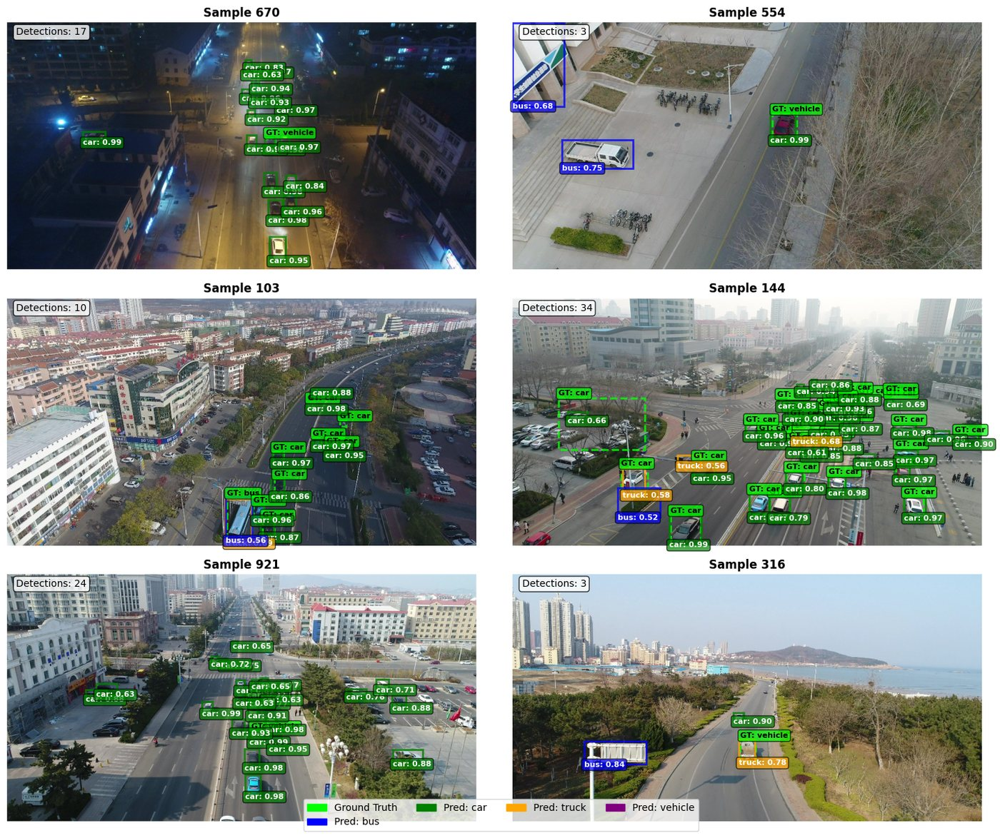
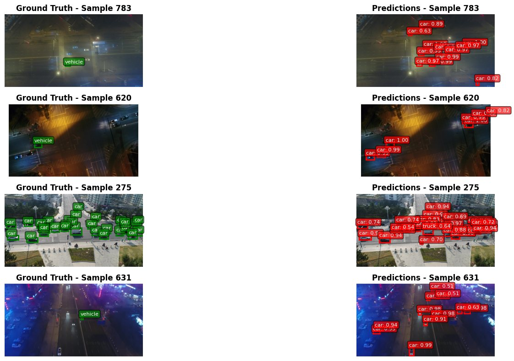

# UAVDT Vehicle Detection

**Fine-tuning a COCO-pretrained Faster R-CNN to find cars, buses and trucks in drone footage from the UAVDT benchmark.**



## What it does

[`uavdt-dataset-training.ipynb`](uavdt-dataset-training.ipynb) is a complete PyTorch pipeline in one notebook:

- a custom `Dataset` that reads UAVDT frames and their JSON box annotations
- a torchvision **Faster R-CNN (ResNet-50 + FPN)** with its classifier head swapped for the UAVDT classes
- a training loop with SGD, a step learning-rate schedule and checkpoints every 5 epochs
- a simple evaluation pass, plus three visualizers: predictions only, ground truth vs prediction side by side, and a confidence-threshold grid

The aerial frames are hard: small vehicles, dense traffic, night scenes, haze and steep camera angles. That makes UAVDT a good test of how far a COCO-pretrained detector moves with very little fine-tuning.

## How it works

**Data.** Each image `M0603_img000325.jpg` has an annotation `M0603_img000325.jpg.json`, Supervisely style: `objects[]` with a `classTitle` and a rectangle in `points.exterior`. `UAVDTDataset` keeps only images that have an annotation. It fixes box corner order, drops degenerate boxes and builds the class map from the files it loaded:

```
train classes: __background__, bus, car, truck
test classes:  __background__, bus, car, truck, vehicle
```

Images are normalised with ImageNet mean and std. There's no augmentation yet. A `max_images` argument (default 1,000) caps how many images load, so a full run fits in one Kaggle session.

**Model.** `fasterrcnn_resnet50_fpn(pretrained=True)` keeps the COCO backbone, FPN and region proposal network. The box predictor is replaced by a `FastRCNNPredictor` with 4 outputs.

```python
model = fasterrcnn_resnet50_fpn(pretrained=True)
in_features = model.roi_heads.box_predictor.cls_score.in_features
model.roi_heads.box_predictor = FastRCNNPredictor(in_features, num_classes)
```

**Training.**
- Optimiser: SGD with learning rate 0.005, momentum 0.9 and weight decay 5e-4.
- Schedule: `StepLR(step_size=3, gamma=0.1)`.
- Batch size: 4, with a custom `collate_fn` so images of different sizes can share a batch.
- The loss is the sum of Faster R-CNN's four losses: classifier, box regression, objectness and RPN box.

## Results

These are from the saved notebook run on a Kaggle Tesla T4:

| | |
|---|---|
| Training data | 1,000 of 24,143 annotated training frames |
| Training | 2 epochs × 250 iterations, about 5 min 15 s per epoch |
| Average loss | **0.7252** after epoch 1 → **0.4812** after epoch 2 |
| Test data | 1,000 of 53,676 test frames |
| Detections (score > 0.5) | **11,114** in total, **11.11 per image** |

From the visualisation cells, average detections per image on small random samples were 15.00 at a 0.3 threshold, 10.17 at 0.5 and 5.62 at 0.8.



**How to read these numbers.** They show the detector working, but they don't measure accuracy. The notebook counts detections and doesn't compute mAP, precision or recall yet. The test split also labels many vehicles with a generic `vehicle` class the model never trained on, and some test frames carry only one box (see above), so raw counts can't be scored against ground truth. Next steps:

1. Map `vehicle` onto the training classes, or train on all four.
2. Add COCO-style mAP@[.5:.95] with `torchmetrics` or `pycocotools`.
3. Train longer on more than 4% of the training frames, with flips and scale jitter.

## Run it

**On Kaggle (easiest).** Open the notebook, attach the dataset `shakaibkaggle/uavdt-dataset`, switch the accelerator to a GPU and click *Run all*. The notebook expects `/kaggle/input/uavdt-dataset`.

**Locally:**

```bash
git clone https://github.com/shakaibarsalan/UAVDT-Dataset-Training.git
cd UAVDT-Dataset-Training
pip install torch torchvision numpy matplotlib tqdm pillow kagglehub jupyter
python -c "import kagglehub; print(kagglehub.dataset_download('shakaibkaggle/uavdt-dataset'))"
jupyter notebook uavdt-dataset-training.ipynb
```

Set `dataset_path`, in the cell that builds the datasets and loaders, to the folder that download printed. It should contain `train/img`, `train/ann`, `test/img` and `test/ann`. The cell before it only demos `max_images` against the Kaggle path, so skip it or change the path there too.

Settings you'll want to change:
- `max_images` loads more data. Pass `float('inf')` to use every annotated frame.
- `num_epochs` in `main()` trains longer.
- `batch_size` should match your GPU memory.
- `confidence_threshold` in the visualisers filters weak boxes.

`main()` writes the final weights to `/kaggle/working/faster_rcnn_final.pth` and a checkpoint every 5 epochs. Change the path when running outside Kaggle. `load_trained_model()` and `predict_single_image()` reload the weights for inference on new frames.

## Tech stack

Python 3.11 · PyTorch · torchvision (Faster R-CNN ResNet-50 FPN) · NumPy · Pillow · Matplotlib · tqdm · Kaggle (Tesla T4)

## License

The code is under the [MIT License](LICENSE). The UAVDT dataset and its images belong to their authors and are used here for research. The dataset isn't included in this repo.

## Author

**Muhammad Shakaib Arsalan**: [shakaib.vercel.app](https://shakaib.vercel.app) · [LinkedIn](https://www.linkedin.com/in/shakaib-arsalan)
